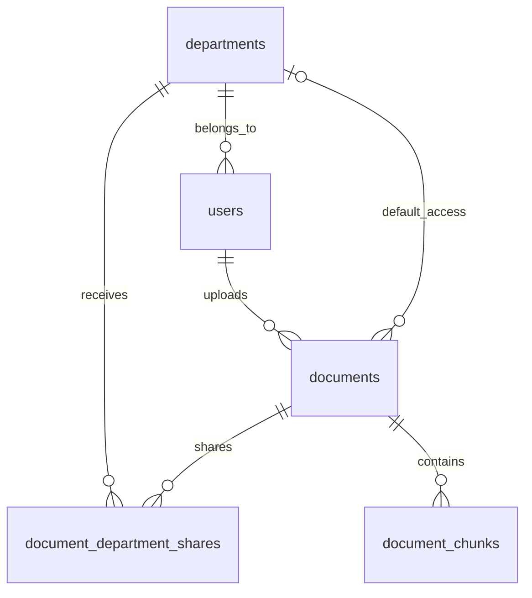
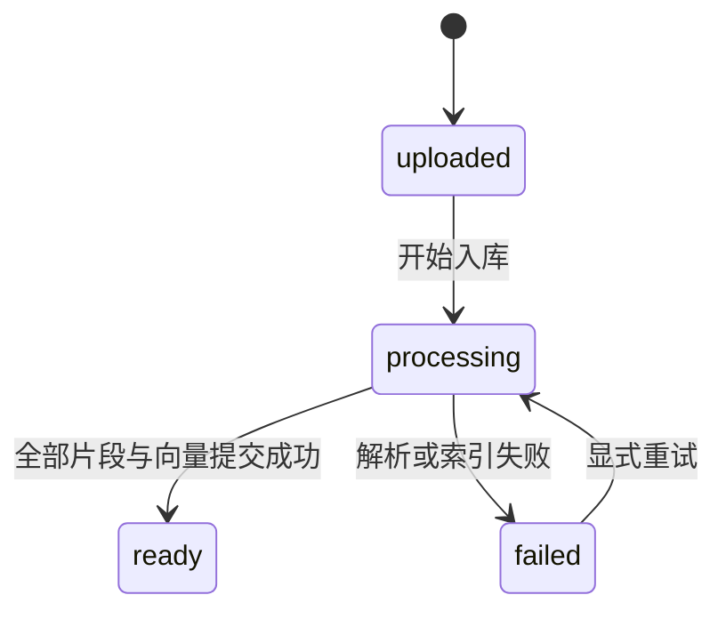

# KnowledgeHub 数据库设计草案

日期：2026-10-26。范围：阶段 2 的数据库设计；尚未创建数据库、ORM 或迁移。

本设计基于 [需求文档](requirements.md)。已确认全员＋部门、敏感等级和跨部门共享。单部门归属、管理员管理范围等尚未最终确认，以下明确采用设计假设，不视为已实现功能。

设计尺度：实现完整入库、权限检索和有来源的问答，保持适合个人开发与讲解的规模。文档表采用 11 个字段；统一模型配置，不增加任务调度、自动恢复或文档版本管理所需的数据。

## 1. 先理解五张表

一份《部署手册》属于文档。它可以被切成几十个片段，每个片段有自己的文字、位置和向量。文档的权限只保存一份；片段通过文档 ID 找到权限。

| 表 | 一个记录代表什么 | 为什么单独存 |
| --- | --- | --- |
| departments | 一个部门 | 名称统一维护，引用必须指向存在的部门 |
| users | 一个用户 | 保存身份、部门和访问等级 |
| documents | 一份上传文档 | 保存权限、文件信息和整体处理状态 |
| document_department_shares | 一份文档额外共享给一个部门 | 表达多对多关系，支持单独撤销和防重 |
| document_chunks | 一个可检索的文档片段 | 检索针对片段，返回引用仍能追溯到文档 |



图中 documents 的部门是“默认允许访问部门”，不是文档所有者。为空表示不限制部门。上传者也不自动获得绕过阅读规则的权限。

## 2. 通用约定

- 主实体 ID 使用应用生成的 UUID；共享表使用两个外键组成主键，不额外增加无用途的 ID。
- 时间使用 PostgreSQL `timestamptz`，应用使用带时区时间；展示时再转用户时区。
- 除明确标记可空的字段外，字段均不允许为空。字符串长度上限在 API Schema 设计时统一确定。
- 固定等级使用 smallint 加 `CHECK (值 BETWEEN 1 AND 3)`；同时设置 NOT NULL，不能只依赖 CHECK 排除空值。
- ID 难以猜测不是权限控制。客户端传来的用户部门、等级和管理员标识不能作为可信授权依据。

## 3. 字段草案

### departments

| 字段 | 建议类型 | 约束与用途 |
| --- | --- | --- |
| id | uuid | 主键 |
| name | text | 非空白、唯一；第一版采用扁平部门结构 |
| created_at | timestamptz | 创建时间 |

已有用户、文档或共享关系引用的部门禁止直接删除。尤其不能通过 ON DELETE SET NULL 将部门文档意外变成全员文档。

### users

| 字段 | 建议类型 | 约束与用途 |
| --- | --- | --- |
| id | uuid | 主键 |
| email | text | 作为登录标识；入库前统一规范化并保证唯一 |
| password_hash | text | 只保存密码哈希，不保存原密码；算法在认证实现时确定 |
| display_name | text | 展示姓名，不作为登录或权限依据 |
| department_id | uuid | 外键 departments.id；暂按每人一个部门设计 |
| access_level | smallint | 1～3，默认 1；普通用户不能自行修改 |
| is_active | boolean | 默认 true，停用后禁止访问 |
| can_manage_documents | boolean | 默认 false；仅表示管理资格，不代表无限管理范围或阅读豁免 |
| created_at / updated_at | timestamptz | 创建及更新时间 |

不同时增加 role、is_admin 等表达同一资格的字段。最终管理范围、用户授权入口仍待确认；第一批账号可以后续通过受控初始化命令创建，不能开放任意自助提权接口。

建议先停用用户，不提供物理删除；上传者外键使用 RESTRICT，保留文档归属记录。

### documents

| 字段 | 建议类型 | 约束与用途 |
| --- | --- | --- |
| id | uuid | 主键 |
| title | text | 非空白标题 |
| file_path | text | 唯一、由服务端生成的相对文件路径；相对于受控上传目录，不直接返回客户端 |
| file_type | text | 限定 txt、md、docx、pdf；服务端校验实际文件后确定 |
| uploaded_by | uuid | 外键 users.id |
| access_department_id | uuid，可空 | 外键 departments.id；NULL 表示不限制部门 |
| classification_level | smallint | 1～3，必须显式选择，避免无意采用低敏感等级 |
| status | text | uploaded（待处理）、processing（处理中）、ready（成功）、failed（失败） |
| error_message | text，可空 | 失败时保存安全错误摘要；完整堆栈只写日志 |
| created_at | timestamptz | 上传时间 |
| updated_at | timestamptz | 最近更新时间，由应用在修改时更新 |

status 用 CHECK 限定四个值。failed 要求 error_message 为非空白内容，其他状态清空该字段。ready 必须至少有一个完整片段，由入库服务在发布事务内校验。

标题未填写时，可由上传文件名生成。文件名不直接作为保存路径；例如服务端保存为 `文档UUID.pdf`，防止重名覆盖和用户控制路径。第一版不单独保存原文件名、文件大小、摘要、索引完成时间或详细处理阶段。上传格式与大小仍需校验，删除字段不代表删除校验。

### document_department_shares

| 字段 | 建议类型 | 约束与用途 |
| --- | --- | --- |
| document_id | uuid | 外键 documents.id，删除文档时 CASCADE |
| department_id | uuid | 外键 departments.id，删除部门时 RESTRICT |

两字段组成主键，防止重复共享。全员文档不配置共享，不重复共享给默认允许部门。这两项涉及 documents 表，不能假装普通 CHECK 能跨表保证；通过授权服务在事务内锁定文档、校验并修改，所有授权写入统一走此入口。

把部门文档改为全员时，在同一个事务中删除共享关系。共享关系只扩大部门范围，不改变敏感等级。

### document_chunks

| 字段 | 建议类型 | 约束与用途 |
| --- | --- | --- |
| id | uuid | 主键；作为引用片段标识 |
| document_id | uuid | 外键 documents.id，删除文档时 CASCADE |
| chunk_index | integer | 从 0 开始，文档内顺序；与 document_id 组合唯一 |
| content | text | 非空白片段原文 |
| source_locator | jsonb | 解析器提供的来源位置，结构见下文 |
| embedding | vector(D) | 不允许为空；D 在选定 Embedding 模型后确定 |
| created_at | timestamptz | 创建时间 |

不复制文档权限到片段表，否则每次改权限都需要同步所有片段，容易产生遗漏。第一版每片段一个向量，所以暂不增加独立 embeddings 表。

来源定位约定：PDF 保存实际页码（从 1 开始）；Markdown 可保存标题路径和原始行号；TXT 可保存原始行号；DOCX 保存段落或表格位置，不编造不稳定的页码。清洗和分片必须保留原文映射；不能用清洗后行号冒充原文件位置。

source_locator 示例：`{"kind":"pdf","page_start":2,"page_end":3}`。具体字段由解析器输出 Schema 校验，允许跨页片段，缺失位置不能由 LLM 猜测补齐。

## 4. 权限如何进入检索

后端从已验证身份重新取得当前用户记录，再执行：

```text
允许检索 = 用户有效
        AND 文档状态为 ready
        AND 用户等级 >= 文档等级
        AND (文档部门为空
             OR 文档部门 = 用户部门
             OR 存在该文档共享给用户部门的记录)
```

查询从 document_chunks 关联 documents，通过 EXISTS 判断共享关系，避免多条共享记录把结果重复展开。用户条件和文档条件都在 SQL 查询中表达，然后对允许访问的片段计算相似度、排序和限制数量；不先取全库 Top-K 再用 Python 过滤。

文档列表、引用详情和下载复用同一阅读规则，但处理状态需按接口区分：员工检索只看 ready，授权管理者查看处理状态走单独管理权限。读取权限与管理权限不混成一个判断。

模型调用期间权限可能变化。返回回答前再次校验本次使用的全部证据；如任一证据权限已撤销，丢弃该答案并要求重新查询，不能只删除引用却保留来自该文档的答案。重新查看引用时也按当前权限检查。已发送到外部模型的数据无法事后撤回，这是此方案的边界。

## 5. 向量与索引的取舍

第一版使用一个确定的 Embedding 配置，同一检索空间不混用不同模型。模型、维度及分片参数放在应用配置中，不逐文档记录。文档和查询必须使用同一配置；向量维度相同也不代表两个模型的向量可以比较。切换模型时暂停检索，将现有文档统一重新入库后再开放；维度变化还需调整向量列。不能直接修改配置后继续查询旧向量。

先采用精确向量检索验证质量，小规模样本不急于创建 HNSW/IVFFlat。后续数据量增加，再根据延迟和召回评估选择近似索引；近似检索与权限过滤组合需特别测试召回。

建议普通索引：users.department_id；documents 的部门、状态和等级按实际查询计划优化；共享表已有主键 (document_id, department_id)，另考虑反向 (department_id, document_id)；片段唯一约束 (document_id, chunk_index) 同时支持按文档读取。

目前不指定 D、模型、相似度阈值和 PostgreSQL/pgvector 版本；选型后再写可执行迁移并验证，不留下猜测的固定维度。

## 6. 入库状态与事务边界



推荐执行顺序：

1. 验证上传者管理资格、文件、大小和目标权限，保存文件，再用短事务写入 uploaded 记录。数据库写入失败时清理文件；文件系统与 PostgreSQL 不共享事务，需要补偿。
2. 用带状态条件的 UPDATE 将 uploaded/failed 文档改为 processing，并清空旧错误，避免对同一文档重复启动处理。
3. 在数据库事务外解析、分片和调用 Embedding；不要让模型网络等待占用长数据库事务。初版在有大小上限的文件范围内暂存结果。
4. 用一个短事务核对文档状态，写入所有完整片段和向量，将状态改为 ready，再一起提交。失败则全部回滚，不暴露半成品。
5. 在另一个短事务记录 failed 和安全错误摘要；若数据库本身不可用，先记录日志，不能声称失败状态一定已经写入。

第一版不实现自动任务恢复。进程崩溃可能遗留 processing；确认旧处理已经停止后，人工将状态修正为 failed，再显式重试。四个状态用于让处理结果清楚可见，不扩展为任务调度系统。

本轮不决定后台任务框架，也不把 create_task 当作可靠队列。上传返回时机与执行方式将在接口/生命周期设计中明确。

第一版不提供 ready 文档的原位重建或替换；可按新文档上传，之后删除旧文档。这样引用不会在后台静默指向被替换的文本。

删除 API 不属于本轮设计交付，不增加 deleting 状态。后续实现删除时，再确定文件清理与数据库删除的失败处理；processing 文档不能直接删除，避免与入库并发冲突。

## 7. 为什么不加 Checkpoint 表

上述表保存业务事实。未来 Graph State 只携带本次问题、检索证据、判断、答案和引用等执行数据，不能成为文档权限的权威来源。

Checkpoint 是保存工作流状态的机制，不替代 documents/document_chunks。是否引入会话仍待确认；本轮不设计会话表或手工创建 LangGraph 内部表。

## 8. 设计核对案例

以下为设计推演及后续测试依据，不代表实际 SQL/API 已测试。

| 用户 | 文档 | 预期 |
| --- | --- | --- |
| 技术部 L2，有效 | 技术部 L2，ready | 允许 |
| 技术部 L2，有效 | 人事部 L1，无共享，ready | 拒绝 |
| 技术部 L2，有效 | 人事部 L2，共享给技术部，ready | 允许 |
| 技术部 L2，有效 | 人事部 L3，共享给技术部，ready | 拒绝 |
| 技术部 L1，有效 | 全员 L3，ready | 拒绝 |
| 技术部 L1，有效 | 全员 L1，ready | 允许 |
| 技术部 L3，停用 | 全员 L1，ready | 拒绝 |
| 技术部 L3，有效 | 技术部 L1，failed | 不参与检索 |
| 技术部 L3，有效 | 技术部 L1，processing | 不参与检索 |

后续数据库集成测试还需覆盖：重复共享、无效外键、等级空值及越界、非空文档没有完整片段却被标记 ready、事务回滚、重复领取任务、权限撤销、部门删除不扩大访问范围。

## 9. 依据、限制与下一步

已核对官方资料：

- [PostgreSQL 约束文档](https://www.postgresql.org/docs/current/ddl-constraints.html)：使用 NOT NULL、CHECK、唯一约束及外键；跨表业务规则不放进普通 CHECK。
- [pgvector 官方项目说明](https://github.com/pgvector/pgvector)：支持精确与近似向量检索；具体维度和索引限制待版本与模型选定后验证。

本次交付数据库设计草案，不宣称数据库迁移、权限 SQL、解析器或 Graph 已实现。下一步围绕模块调用与接口输入输出继续阶段 2，并确认管理权限边界。无需为本文件安装依赖或启动参考项目。
